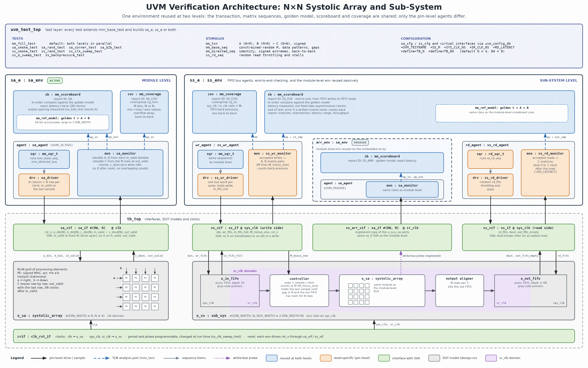

# UVM Verification of the N x N Systolic Array and Sub-System

This design-verification project provides a UVM testbench for the systolic array (module level) and the sub-system with FIFOs and two clocks (sub-system level).

## 1. Package contents

| File | What it contains |
|---|---|
| `testbench.sv` | The UVM testbench: interfaces, the `mm_tb_pkg` package (transaction, sequences, agents, golden model, scoreboard, coverage, environments, tests) and the top module `tb_top` |
| `design.sv` | A cycle-accurate SystemVerilog model of the DUT (`systolic_array`, `sub_sys` and their sub-blocks). It is the optional "cycle accuracy performance/function model". It also lets the testbench run before the real RTL exists. |
| `README.md` | This document: how to run, DV architecture, verification plan, assumptions |
| `dv_architecture.png` | DV architecture diagram (section 3). Not needed to run on EDA Playground |

## 2. Running on EDA Playground

1. Log in at https://edaplayground.com. You need an account to use the commercial simulators.
2. In the left panel, set:
   - **Testbench + Design:** `SystemVerilog/Verilog`
   - **UVM / OVM:** `UVM 1.2`
   - **Tools & Simulators:** `Synopsys VCS` (newest version listed). `Cadence Xcelium` and `Aldec Riviera-PRO` should also work.
3. Paste `testbench.sv` into the left editor pane (`testbench.sv`). Paste `design.sv` into the right editor pane (`design.sv`).
4. **Compile Options:** keep the defaults. To change the DUT parameters, add for example `+define+TB_N=8 +define+TB_DW=16`. The defaults are N=4 and DIN_WIDTH=8, and BUS_WIDTH is derived as 2*DIN_WIDTH*N.
5. **Run Options:** leave empty to run `mm_full_test`, which covers both levels. To pick another test, add for example `+UVM_TESTNAME=ss_clk_sweep_test`. To change the random seed on VCS, use `+ntb_random_seed=<n>`.
6. Tick **Open EPWave after run**, then press **Run**.
7. Pass/fail: near the end of the log there is a banner like this:

```
==========================================================================
  TEST mm_full_test : PASSED   (UVM_ERROR=0  UVM_FATAL=0)
  N=4  DIN_WIDTH=8  BUS_WIDTH=64
  [SA]     matrices in/out x/x  match x  mismatch 0  pending 0  latency 8..8 clk
  [SS_E2E] matrices in/out y/y  match y  mismatch 0  pending 0  latency ... ns
  [SS_ARR] matrices in/out y/y  match y  mismatch 0  pending 0  latency 8..8 clk
  SS bus  writes ... (back-pressure cycles ...), reads ...
==========================================================================
```

The log also contains the UVM topology, the first matched matrices printed in full (A, B and C), throughput and latency statistics, and functional coverage percentages.

### Run-time options (plusargs)

| Option | Effect |
|---|---|
| `+UVM_TESTNAME=<test>` | Select a test (see section 5) |
| `+SYS_CLK_NS=<ns>` `+SR_CLK_NS=<ns>` | Sub-system clock periods at start, e.g. `+SYS_CLK_NS=7.5 +SR_CLK_NS=3.1` |
| `+SA_CLK_NS=<ns>` | Module-level clock period |
| `+SS_M=<1..256>` | Sub-system M (`M_minus_one = M-1`) for tests that use one M |
| `+SA_LATENCY=<clk>` | Expected `in_valid` to `out_valid` latency, for the stand-alone array and for the array inside `sub_sys`. The model value is 2N; `-1` disables the check. |
| `+RD_LATENCY=<0\|1>` | `dout` is valid in the same, or the next, sys_clk after an accepted read (default 1). The monitor and the `dout` assertion follow this setting. |
| `+NO_ARR_MON` | Turn off the white-box monitor on the array inside `sub_sys` |
| `+SB_PRINT=<n>` | Print full matrices for the first n matches of each scoreboard |
| `+WAVE_FULL` / `+WAVE_NS=<ns>` / `+NO_WAVES` | Dump the whole hierarchy (every PE) / change the dump window (default 20 us, 0 = whole run) / no dump |

### Waveform screenshots (EPWave)

EPWave cannot display unpacked arrays, so `tb_top` provides one wire per element.

- **Module level, consecutive matrix multiplications:** `sa_clk`, `sa_in_valid`, `W_SA[*].a_din`, `W_SA[*].b_din`, `sa_out_valid`, `W_SA[*].c_dout`. The first matrices are directed and back-to-back (M = N). You can see one result matrix every M clocks, with rows leaving on consecutive clocks and `out_valid` on the last row.
- **Sub-system:** `ss_sys_clk`, `ss_sr_clk`, `ss_wr_fifo`, `W_SS[*].din_a/din_b`, `ss_in_full`, `ss_arr_in_valid`, `W_SS[*].arr_a/arr_b/arr_c`, `ss_arr_out_valid`, `ss_rd_fifo`, `ss_out_empty`, `W_SS[*].dout_c`. Inside `u_ss` you also find `smp_cnt`, `gap_cnt`, `pend_rows`, `in_pop` and `drain_left`.

## 3. DV architecture



The diagram above is `dv_architecture.png` in this package. The text tree below shows the same structure for viewers that do not display images.

```
 tb_top
  |-- clk_rst_if            programmable clk / sys_clk / sr_clk (period and phase, changeable at run time)
  |-- sa_if  sa_vif  ------ systolic_array u_sa      (module-level DUT)
  |-- ss_if  ss_vif  ------ sub_sys u_ss             (sub-system DUT)
  |-- sa_if  ss_arr_vif <-- probe of u_ss.u_sa       (array inside the sub-system)

 uvm_test_top (mm_full_test / sa_* / ss_* tests, all derived from mm_base_test)
  |-- sa_e : sa_env (ACTIVE)                       module level
  |     |-- agent : sa_agent    sqr -> drv  (A column + B row per clock, in_valid on the last sample)
  |     |                       mon        (re-assembles A/B and C; idle-zero, X and overlap checks)
  |     |-- sb    : mm_scoreboard  golden model, in-order compare, exact latency, throughput
  |     `-- cov   : mm_coverage
  `-- ss_e : ss_env                                sub-system level
        |-- wr_agent : ss_wr_agent   sqr -> drv   (bus words into the input FIFO, honours in_fifo_full)
        |                            mon          (accepted writes -> A/B matrix pairs, M from M_minus_one)
        |-- rd_agent : ss_rd_agent   sqr -> drv   (random read throttling and stalls on rd_fifo)
        |                            mon          (accepted reads -> C matrices)
        |-- sb  : mm_scoreboard  end-to-end, clock-ratio independent
        |-- cov : mm_coverage    + clock-ratio x M, back-pressure and bus back-to-back coverage
        `-- arr_env : sa_env (PASSIVE)  module-level env re-used on the embedded array
                                        (scoreboard + checks; no matrix coverage, because idle
                                         bubbles inside the sub-system inflate the observed M)
```

### Re-use between the two levels

| Component | Module level | Sub-system level |
|---|---|---|
| `mm_txn` (A: N x M, B: M x N, C: N x N) | stimulus and observation | stimulus and observation |
| `mm_base_seq`, `mm_directed_seq` | drive `sa_agent` | drive `ss_wr_agent` (unchanged) |
| `mm_ref_model` (golden C = A x B) | scoreboard and coverage | scoreboard and coverage |
| `mm_scoreboard` | `SA` | `SS_E2E` and `SS_ARR` |
| `mm_coverage` | `SA_COV` | `SS_COV` (adds clock ratio, back-pressure and bus back-to-back coverage) |
| `sa_env` / `sa_agent` / `sa_monitor` | active | passive, inside `ss_env` |

Only the pin-level drivers and monitors are level-specific. A failure in the sub-system is therefore localised immediately:

- `SS_ARR` fails: the array, or the data alignment in front of it, is wrong.
- `SS_E2E` fails while `SS_ARR` passes: the FIFOs, CDC or output alignment are wrong.

## 4. Verification plan

| # | Feature | Check | Tests | Coverage |
|---|---|---|---|---|
| F1 | C = A x B for every matrix pair, signed, wrapping modulo 2^(2*DIN_WIDTH) | Scoreboard vs golden model, element by element | all | M bins, data patterns |
| F2 | Inner dimension M = 1..256 (module: random per matrix; sub-system: `M_minus_one` 0..255) | Scoreboard | `sa_rand_test`, `sa_corner_test`, `ss_m_sweep_test`, `mm_full_test` | `cp_m`, M<N / M=N / M>N |
| F3 | Streaming throughput: one C matrix every M clocks (M >= N), no bubbles | `sa_b2b_test` fails unless every `out_valid` spacing is exactly N clocks (64 pairs, M = N, no gaps). In the other tests, the `SA` and `SS_ARR` scoreboards measure the spacing and print its range in the log (not a pass/fail check) | `sa_b2b_test` (checked); all other tests, including `mm_full_test`, report it | back-to-back x M relation (`x_rel_b2b`) |
| F4 | Fixed latency `in_valid` to `out_valid` (2N in the model) | Scoreboard latency check (`+SA_LATENCY`) | all module level, `SS_ARR` | none |
| F5 | `c_dout` = 0 when no result is being returned | Monitor idle-zero check | all | none |
| F6 | Handshake rules: `in_valid` spacing (P3), no X/Z after reset, no overlapping result windows | SVA in `sa_if` / `ss_if`, monitor checks | all | none |
| F7 | Signed extremes and overflow: -2^(W-1) x -2^(W-1), max x min, alternating extremes, zero, sparse, identity | Scoreboard | `sa_corner_test`, directed, random | `cp_a_min/max`, `cp_wrap`, `cp_neg/pos` |
| F8 | FIFO handshake: write ignored when full, read ignored when empty, `dout` one sys_clk after a read | Write/read monitors, end-to-end scoreboard, SVA | `ss_backpressure_test`, all `ss_*` | `cp_bp` |
| F9 | Asynchronous clocks: any sys_clk / sr_clk ratio and phase, changed at run time | End-to-end scoreboard under clock sweeps | `ss_clk_sweep_test`, `ss_rand_test`, `mm_full_test` | `cp_ratio` x M relation |
| F10 | Data alignment inside the sub-system (bus word <-> array ports <-> bus word) | `SS_ARR` passive scoreboard + `SS_E2E` | all `ss_*` | none |
| F11 | Reset | X checks once reset is released, re-sync of monitors | all | none |
| F12 | Design parameters N, DIN_WIDTH, BUS_WIDTH | Same tests, recompiled with `+define+TB_N / TB_DW` | regression | none |

### Suggested regression

| Run | Compile options | Run options |
|---|---|---|
| 1 | (default N=4, DW=8) | (default `mm_full_test`) |
| 2 | default | `+UVM_TESTNAME=sa_corner_test` |
| 3 | default | `+UVM_TESTNAME=sa_b2b_test` |
| 4 | default | `+UVM_TESTNAME=ss_clk_sweep_test` |
| 5 | default | `+UVM_TESTNAME=ss_backpressure_test` |
| 6 | default | `+UVM_TESTNAME=ss_rand_test +ntb_random_seed=<n>` (several seeds) |
| 7 | `+define+TB_N=8` | default |
| 8 | `+define+TB_N=2 +define+TB_DW=16` | default |
| 9 | `+define+TB_N=3 +define+TB_DW=5` | `+UVM_TESTNAME=ss_m_sweep_test` |
| 10 | `+define+TB_N=1` | default |

## 5. Tests

| Test | Level | Content |
|---|---|---|
| `mm_full_test` (default) | both, in parallel | Directed; corners (wrap, M=1, M=196..256, sparse/zero); 150 random matrices; sub-system M sweep combined with 7 clock relationships; back-pressure phase |
| `sa_smoke_test` | module | Directed only (identity, small values back-to-back, extremes) |
| `sa_rand_test` | module | 300 random matrices, random M (1..3N) and gaps |
| `sa_corner_test` | module | Long M with extreme values, M=256, M=1 back-to-back, alternating/zero/sparse |
| `sa_b2b_test` | module | 64 matrices with M=N and no gaps; checks one result every M clocks |
| `ss_smoke_test` | sub-system | Directed + 20 random, equal clocks |
| `ss_rand_test` | sub-system | Random M, random clock periods (2..20 ns) and phase, 150 matrices |
| `ss_clk_sweep_test` | sub-system | 7 sys_clk/sr_clk relationships (equal, 3x, 1/2.5x, non-integer ratios) |
| `ss_m_sweep_test` | sub-system | M = 1, N-1, N, N+1, 2N, 3N+1, 64, 256 |
| `ss_backpressure_test` | sub-system | Fast writer, slow bursty reader; `in_fifo_full` must occur |

## 6. Assumptions

The specification leaves the cycle-level protocol open. These are the assumptions the testbench checks (P = array, S = sub-system). They are concentrated in the drivers and monitors, so they can be changed in one place.

**Systolic array**

- **P1** One sample per clock: `a_din[i] = A[i][k]` (column k of A), `b_din[j] = B[k][j]` (row k of B), k = 0..M-1. A matrix pair takes M clocks.
- **P2** `in_valid` is a one-clock pulse on the last sample (k = M-1) of each pair, as the spec says ("indicates last elements ... each M clock cycle"). There is no per-sample valid, so idle clocks carry `a_din = b_din = 0`.
- **P3** Two `in_valid` pulses are at least N clocks apart. N result rows share one N-wide output port, so a pair with M < N is followed by idle clocks. M >= N streams without bubbles.
- **P4** C leaves row by row on N consecutive clocks: `c_dout[j] = C[i][j]`, rows 0..N-1. `out_valid` = 1 with the last row (row N-1). `c_dout` = 0 at all other times.
- **P5** Latency is fixed. The model value is `out_valid` 2N clocks after `in_valid`; for the real RTL, set it with `+SA_LATENCY`.
- **P6** `c_din` is held at 0: the lab computes C = A x B and ignores D.
- **P7** Elements are signed two's complement. C elements are 2*DIN_WIDTH bits and wrap on overflow; the golden model wraps the same way.

**Sub-system**

- **S1** One bus word per sample: `din[i*DW +: DW] = A[i][k]`, `din[N*DW + j*DW +: DW] = B[k][j]` (BUS_WIDTH = 2*DW*N). M consecutive accepted writes form one matrix pair.
- **S2** One bus word per C row: `dout[j*2DW +: 2DW] = C[i][j]`. N consecutive accepted reads form one C matrix, rows in order.
- **S3** A write while `in_fifo_full` = 1 is ignored; the testbench holds the word and retries. A read while `out_fifo_empty` = 1 is ignored. `dout` is valid one sys_clk after an accepted read (`+RD_LATENCY=0` for a fall-through FIFO).
- **S4** `M_minus_one` is quasi-static. The testbench changes it, and the clock periods, only when the sub-system is idle (all results read).
- **S5** sys_clk and sr_clk are asynchronous to each other, with any ratio and phase.
- **S6** `rst_n` is asynchronous and resets both domains.

**Model-only choices** (these belong to `design.sv`, not the spec):

- The controller holds the last sample of a pair until rule P3 and output-FIFO space allow it. The array therefore never stalls and the output FIFO never overflows.
- The input FIFO is 16 deep; the output FIFO is at least 4N deep. Gray-code pointers and 2-flop synchronisers are used.

## 7. Checking strategy and efficiency choices

- **One golden model, four users.** `mm_ref_model` computes C with 64-bit accumulation and wraps to 2*DIN_WIDTH bits. The module scoreboard, both sub-system scoreboards and the coverage collector all use it, so there is one source of truth.
- **Transaction-level stimulus, independent of the level.** A sequence describes "matrix pairs". The level-specific drivers turn them into array samples or FIFO words, so every sequence and test idea is shared by both levels.
- **Monitors rebuild transactions from pins only.** The scoreboard never trusts the stimulus side; it checks what the DUT actually saw. M at the sub-system level is taken from the `M_minus_one` pin.
- **Timing-independent end-to-end check.** The sub-system scoreboard is an in-order queue, so any clock ratio, phase, back-pressure or read throttling needs no testbench change. Exact timing (latency, throughput, idle zeros) is checked where it is deterministic: at the array, at both levels.
- **White-box re-use for fast debug.** `sa_env` in passive mode on the embedded array splits a sub-system failure into "array" or "FIFO/CDC/alignment" at once.
- **Pattern-directed constrained random.** Patterns (identity, max/min, alternating extremes, zero, sparse, small, full range) reach overflow and sign corners much faster than uniform random. Identity matrices make a failure self-explaining (C must equal A or B). Gaps are biased towards 0 to stress back-to-back streaming.
- **Self-checking assertions** in the interfaces (P3 spacing, X/Z on handshakes, `dout` after reads) catch protocol bugs at the cycle where they occur.
- **One compile, every configuration.** N and DIN_WIDTH are compile defines; clocks, M, latency and verbosity are plusargs. Both DUTs are in one top and the test chooses the level(s), so EDA Playground needs no file edits for a regression.
- **Readable logs.** The first matches print full matrices; mismatches print A, B, expected and observed C. A final PASS/FAIL banner summarises each scoreboard.

## 8. Using the real RTL instead of the model

1. Replace `design.sv` with the RTL. Keep the module and port names from the specification.
2. In `tb_top`, adjust the 7-line white-box probe block to the RTL's instance path of the array inside `sub_sys`. Alternatively, delete the block and run with `+NO_ARR_MON`.
3. Set `+SA_LATENCY=<rtl latency>`, or `-1` if it is not fixed, and `+RD_LATENCY=0` for a fall-through output FIFO.
4. If the RTL uses a different array protocol (for example, a weight-stationary array that needs B preloaded), only `sa_driver` and `sa_monitor` change. Sequences, golden model, scoreboard, coverage and sub-system agents stay as they are.

## 9. Performance of the cycle-accurate model

| Metric | Value |
|---|---|
| Array latency | `out_valid` 2N clocks after `in_valid`. For N = M = 2, with the first sample in cycle 0, `out_valid` is high in cycles 5 and 7: the 6th and 8th clock, as in the spec's example. |
| Array throughput | One C matrix every max(M, N) clocks (one every M for M >= N) |
| Sub-system throughput | Per matrix: max(M, N) sr_clk cycles in the array, M sys_clk writes and N sys_clk reads (writes and reads run in parallel). The slowest of these sets the rate. The log reports matrices/us and mean latency. |
